
<a href="https://github.com/ahaan-shah"><picture><source media="(prefers-color-scheme: dark)" srcset="./map/title-dark.svg" /></picture></a> <a href="https://github.com/ahaan-shah/opentern"><picture><source media="(prefers-color-scheme: dark)" srcset="./map/opentern-dark.svg" /></picture></a><a href="https://github.com/ahaan-shah"><picture><source media="(prefers-color-scheme: dark)" srcset="./map/hub-dark.svg" /></picture></a><a href="https://github.com/ahaan-shah/spotsie"><picture><source media="(prefers-color-scheme: dark)" srcset="./map/spotsie-dark.svg" />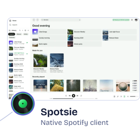</picture></a> <a href="https://github.com/ahaan-shah/magpie"><picture><source media="(prefers-color-scheme: dark)" srcset="./map/magpie-dark.svg" />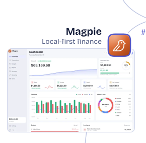</picture></a><a href="https://github.com/ahaan-shah?tab=repositories"><picture><source media="(prefers-color-scheme: dark)" srcset="./map/egui-dark.svg" /></picture></a><a href="https://github.com/ahaan-shah/dotfiles"><picture><source media="(prefers-color-scheme: dark)" srcset="./map/hyprahaan-dark.svg" />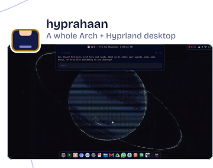</picture></a> <a href="https://github.com/ahaan-shah/pear"><picture><source media="(prefers-color-scheme: dark)" srcset="./map/pear-dark.svg" />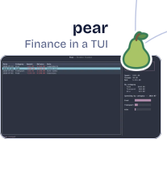</picture></a><a href="https://github.com/ahaan-shah/peach"><picture><source media="(prefers-color-scheme: dark)" srcset="./map/peach-dark.svg" />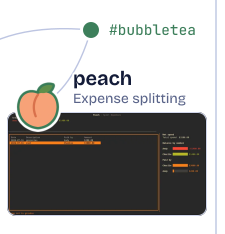</picture></a><a href="https://github.com/ahaan-shah?tab=repositories"><picture><source media="(prefers-color-scheme: dark)" srcset="./map/pywal-dark.svg" />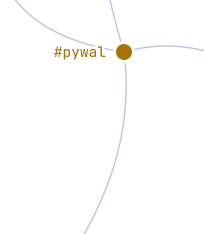</picture></a><a href="https://github.com/ahaan-shah?tab=repositories"><picture><source media="(prefers-color-scheme: dark)" srcset="./map/filefinder-dark.svg" />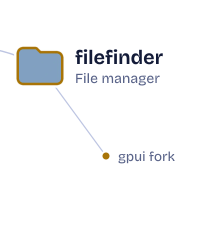</picture></a> <a href="https://github.com/ahaan-shah?tab=repositories"><picture><source media="(prefers-color-scheme: dark)" srcset="./map/data-dark.svg" />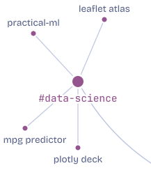</picture></a><a href="https://github.com/ahaan-shah/allwrite"><picture><source media="(prefers-color-scheme: dark)" srcset="./map/allwrite-dark.svg" /></picture></a><a href="https://github.com/ahaan-shah/docview"><picture><source media="(prefers-color-scheme: dark)" srcset="./map/docview-dark.svg" />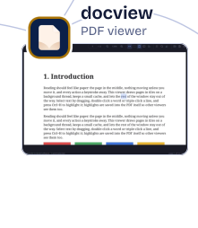</picture></a><a href="https://github.com/ahaan-shah/easycalc"><picture><source media="(prefers-color-scheme: dark)" srcset="./map/easycalc-dark.svg" />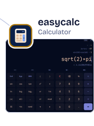</picture></a> <a href="https://github.com/ahaan-shah?tab=repositories"><picture><source media="(prefers-color-scheme: dark)" srcset="./map/scanlab-dark.svg" />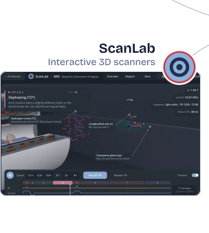</picture></a><a href="https://github.com/ahaan-shah/WMH-Segmentation-in-Brain-MRI"><picture><source media="(prefers-color-scheme: dark)" srcset="./map/wmh-dark.svg" /></picture></a><a href="https://github.com/ahaan-shah/cross-population-xai-heart-disease"><picture><source media="(prefers-color-scheme: dark)" srcset="./map/xai-dark.svg" />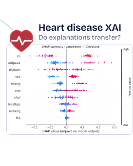</picture></a>

Project list

**Rust and egui**
- [Opentern](https://github.com/ahaan-shah/opentern): a fast, local-first market analysis terminal. [Website](https://ahaan-shah.github.io/opentern/)
- [Spotsie](https://github.com/ahaan-shah/spotsie): a native and light Spotify client for Linux, macOS and Windows. [Website](https://ahaan-shah.github.io/spotsie/)
- [Magpie](https://github.com/ahaan-shah/magpie): a local-first personal finance tracker, and the successor to pear. [Website](https://ahaan-shah.github.io/magpie/)

**Linux apps that follow your pywal colours**
- [hyprahaan](https://github.com/ahaan-shah/dotfiles): a whole desktop for Arch and Hyprland
- [allwrite](https://github.com/ahaan-shah/allwrite): a Markdown editor you write in rendered
- [docview](https://github.com/ahaan-shah/docview): a PDF and web page viewer
- [easycalc](https://github.com/ahaan-shah/easycalc): a keyboard-driven calculator in about 10 MB of RAM
- filefinder: a keyboard-first file manager, built on a [gpui fork](https://github.com/ahaan-shah/gpui)

**Terminal apps in Go**
- [pear](https://github.com/ahaan-shah/pear): personal finance in the terminal
- [peach](https://github.com/ahaan-shah/peach): expense splitting in the terminal

**Biomedical**
- ScanLab: an interactive 3D medical imaging lab for teaching
- [WMH segmentation](https://github.com/ahaan-shah/WMH-Segmentation-in-Brain-MRI): finding and measuring white-matter lesions in brain MRI
- [Heart disease XAI](https://github.com/ahaan-shah/cross-population-xai-heart-disease): do model explanations hold across patient populations? A team project

**Data science coursework**
- [Practical machine learning](https://ahaan-shah.github.io/practical-machine-learning-project/), [Leaflet atlas](https://github.com/ahaan-shah/ddp-leaflet-map), [MPG predictor](https://ahaan-shah.shinyapps.io/mpg-predictor/), [Plotly deck](https://github.com/ahaan-shah/DDP_week3_asssignment), [tidy data](https://github.com/ahaan-shah/getting-and-cleaning-data), [reproducible research](https://github.com/ahaan-shah/RepData_PeerAssessment1), [exploratory analysis](https://github.com/ahaan-shah/Exploratory-Data-Analysis-CourseProject1)

